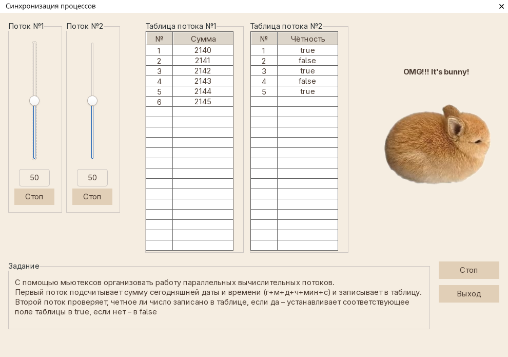

# Синхронизация потоков

Лабораторная работа на C с интерфейсом IUP и синхронизацией через мьютекс.

Первый поток считает сумму текущей даты и времени: год + месяц + день + час + минута + секунда.
Второй проверяет, чётная ли сумма. Результаты отображаются в двух таблицах,
а одинаковые номера связывают сумму и её проверку.

## Управление

- Ползунки меняют скорость соответствующих потоков. Значение можно ввести в поле под ползунком.
- Чем больше число, тем быстрее работает поток: 0 - пауза 5 секунд, 50 - 1 секунда, 100 - 0,1 секунды.
- «Стоп» под ползунком ставит поток на паузу. Повторное нажатие продолжает работу.
- Общая кнопка «Стоп» останавливает оба потока. Если оба уже на паузе, возобновляет их работу.
- «Выход» и крестик окна полностью завершают программу.

